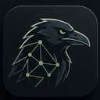
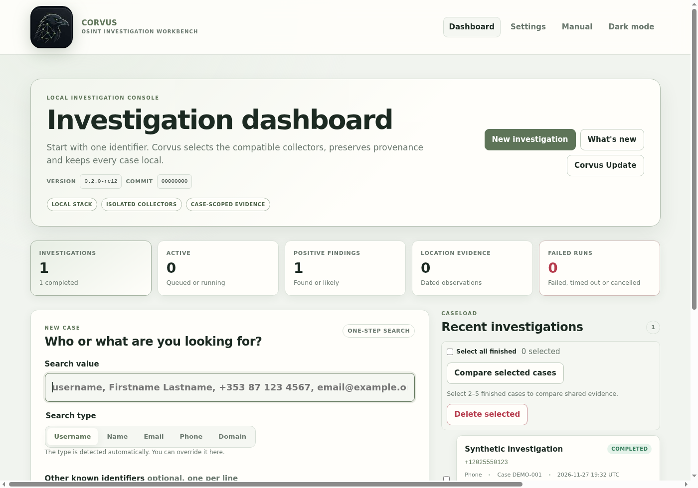

# Corvus



Corvus is a local OSINT workbench for investigations, evidence review and reporting. Rather than switching between individual collectors and manually consolidating their output, you can run compatible tools within a case, review the original source evidence, compare findings and export a report.

**[Download for Windows](https://github.com/sn0ba11/corvus/releases)** · [Installation](docs/DEPLOYMENT.md) · [Documentation](docs/INDEX.md) · [Collector catalogue](docs/COLLECTORS.md)



## What it can do

| Area | Features |
| --- | --- |
| [Investigation management](docs/INVESTIGATIONS.md) | Username, full name, email, phone and domain cases; multiple known identifiers; collector selection; live progress; retry; cross-case comparison |
| [Account and web discovery](docs/DISCOVERY.md) | Maigret, Sherlock, optional Blackbird, extended username coverage, native public-profile collectors, web metasearch, account validation and evidence-backed pivots |
| [Browser and social evidence](docs/BROWSER.md) | Managed Chromium/Firefox, named browser profiles, explicit evidence capture, Instagram browser observations, Telegram and Discord imports, video metadata and individual TikTok evidence capture |
| [Domains and organisations](docs/INFRASTRUCTURE.md) | Passive subdomains, RDAP, certificate and email relationships, historical URLs, bounded site intelligence, public IP/ASN enrichment, company registers and VAT validation |
| [Evidence analysis](docs/ANALYSIS.md) | Unified account views, relationship graphs, timelines, historical captures, location observations, local image and face comparison, retained artifact analysis |
| [Reporting](docs/REPORTING.md) | HTML, JSON and CSV exports; portable evidence bundles; source references, raw results, execution logs, hashes and redaction controls |

See the [collector catalogue](docs/COLLECTORS.md) for individual adapters, input types, requirements and limitations. Optional collectors are not necessarily enabled or available in every deployment.

## Getting started

### Windows

Download the newest setup executable from [Releases](https://github.com/sn0ba11/corvus/releases). Verify its published SHA-256 checksum before running it. Packages are currently unsigned public pre-releases.

### Linux / source

Use Git, Python 3.12 or later and Docker Engine with Compose v2.

```sh
git clone https://github.com/sn0ba11/corvus.git
cd corvus
python3 scripts/installer.py install
```

Open <http://127.0.0.1:8000/> or the address reported by setup. Enter an identifier, confirm its type, choose compatible collectors and start a case. Review positive findings and unresolved results before generating a report.

Windows uses Docker Desktop with WSL 2 for the full stack. Linux runtime and silent Windows 11 installation have been validated; the macOS archive has been built and checked, but native macOS installation testing is deferred. A Docker-free local core is also available. See [installation](docs/DEPLOYMENT.md) and [updates](docs/UPDATER.md).

## Documentation

Start with the [documentation index](docs/INDEX.md), or open the [complete operator manual](docs/MANUAL.md). See [settings](docs/SETTINGS.md), [troubleshooting and backups](docs/OPERATIONS.md), [architecture](docs/ARCHITECTURE.md) and [external integrations](docs/UPSTREAMS.md).

## Privacy and limitations

Case databases, exports and retained captures are stored locally. Selected online collectors and browser actions send queries or URLs to their respective services. Browser profiles can retain authentication cookies. The application does not include telemetry. Source availability, login walls and rate limits affect coverage; a missing result does not necessarily mean an account or record does not exist. Correlation candidates require analyst review.

Use Corvus only for lawful, authorised activity. See [privacy](docs/PRIVACY.md) and [security reporting](SECURITY.md).

## Licence

Copyright (c) 2026 sn0ba11. Corvus uses the [PolyForm Noncommercial License 1.0.0](LICENSE), including its permitted purposes for government, educational and public safety organisations. Commercial exploitation requires separate permission. Retain the [copyright notice](COPYRIGHT).

Third-party tools retain their own licences. Blackbird is optional and must be obtained separately with appropriate permission. See [third-party notices](THIRD_PARTY_NOTICES.md) and [attribution](LICENSES/ATTRIBUTIONS.md).
